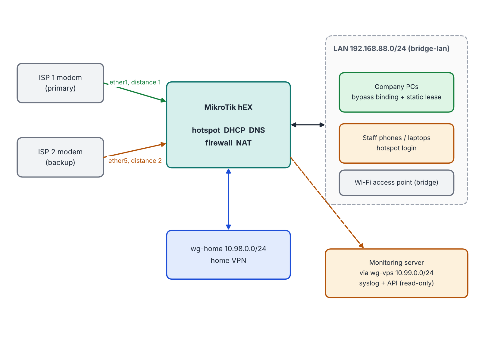
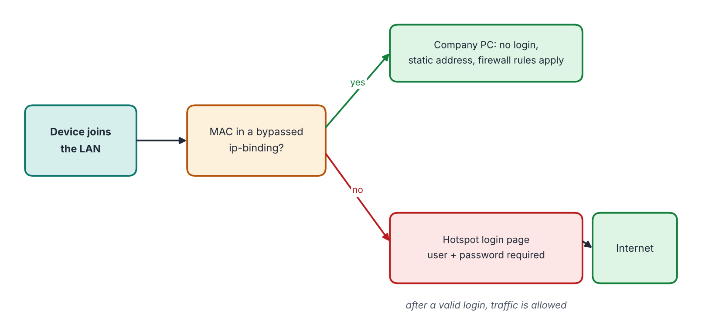

# Office Network and Access Control on MikroTik (RouterOS 7)

A small-office network built on a MikroTik hEX router: hotspot login for staff devices, company PCs that skip the login, fixed DHCP addresses, a firewall with input and forward rules, NAT, two internet lines with failover, and logging to a central server.

Author: Monica P

## What it does

| Goal | How |
| --- | --- |
| Staff and guests must sign in | MikroTik hotspot on the LAN bridge |
| Company PCs do not sign in | hotspot `ip-binding` with `type=bypassed`, matched by MAC address |
| Company PCs are easy to find | static DHCP lease and the comment `Company PC - <hostname>` |
| Router is protected | input chain: accept established, drop invalid, drop everything from the two uplinks |
| Two internet lines | two default routes with `check-gateway=ping` (distance 1 and 2) |
| Safer DNS | upstream filtering DNS, a local list of blocked ad names answered with 127.0.0.1 |
| Visibility | router logs sent to a Wazuh server over a WireGuard tunnel |

## Network at a glance





Text version:

```
 ISP 1 modem --ether1--+
                       +-- MikroTik hEX --bridge-lan 192.168.88.0/24-- company PCs, staff Wi-Fi/APs
 ISP 2 modem --ether5--+        |
                                +-- wg-home 10.98.0.0/24  (home VPN, see the VPN repository)
                                +-- wg-vps  10.99.0.0/24  (logs to the monitoring server)
```

## Folder guide

| Path | Content |
| --- | --- |
| `docs/network-design.md` | addresses, ports, uplinks |
| `docs/hotspot-and-company-pcs.md` | hotspot, bypass bindings, naming |
| `docs/dhcp-and-dns.md` | DHCP pool, static leases, DNS and block list |
| `docs/firewall.md` | input and forward rules, explained |
| `docs/nat-and-failover.md` | masquerade and the two default routes |
| `docs/logging.md` | syslog topics, helper scripts |
| `docs/ap-bridge.md` | using a second router as an access point |
| `docs/security.md` | hardening checklist |
| `docs/troubleshooting.md` | common problems |
| `examples/office-config.rsc.example` | sanitised configuration |
| `scripts/` | RouterOS helper scripts |

## Privacy

All values here are examples. Real MAC addresses, device names, user names, public addresses and keys are not published. Never publish a real `/export`.

## Related

* Home VPN with WireGuard on MikroTik: `home-vpn-wireguard-mikrotik`
* Office monitoring dashboard: `soc-lab-dashboard`

## License

MIT. See `LICENSE`.
